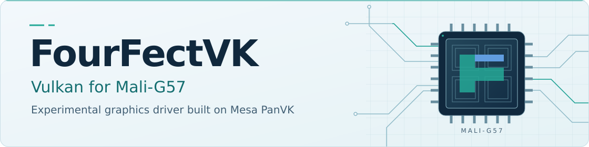

<picture>
  <source media="(prefers-color-scheme: dark)" srcset="docs/assets/fourfectvk-banner-dark.svg">
  <source media="(prefers-color-scheme: light)" srcset="docs/assets/fourfectvk-banner-light.svg">
  
</picture>

  <strong>An open-source Vulkan driver for Mali-G57 on Android.</strong> 
  Built on Mesa PanVK, with development and testing focused on Winlator.

  <a href="https://github.com/Noysz/panvk-g99-jm/releases/tag/fourfectvk-g57-v0.1.0-test9"><strong>Download&nbsp;Test&nbsp;9</strong></a> &nbsp; &middot; &nbsp;
  <a href="#getting-started">Get&nbsp;Started</a> &nbsp; &middot; &nbsp;
  <a href="docs/README.md">Documentation</a> &nbsp; &middot; &nbsp;
  <a href="#development-progress">Development</a> &nbsp; &middot; &nbsp;
  <a href="https://github.com/Noysz/panvk-g99-jm/issues/new?template=test9-report.yml">Report&nbsp;Issue</a>

<strong>Experimental</strong> &nbsp; / &nbsp; Mali-G57 MC2 &nbsp; / &nbsp; Latest public build: Test 9

## About FourFectVK

FourFectVK develops [Mesa PanVK](https://docs.mesa3d.org/drivers/panfrost.html)
for **Mali-G57 MC2**, including the GPU in the MediaTek Helio G99. It adapts
Mesa's open-source Vulkan driver to the stock Mali kernel driver used on the
tested Android device.

For Android and Winlator users, the project offers an experimental graphics
driver for Vulkan applications and Windows games using translation layers
such as DXVK. Compatibility varies by application and runtime; it is not a
replacement for every device's system graphics driver.

## Getting Started

1. **Download** the [Test 9 driver ZIP](https://github.com/Noysz/panvk-g99-jm/releases/download/fourfectvk-g57-v0.1.0-test9/FourFectVK-G57-v0.1.0-test9.zip). Verify it against the checksums on the [release page](https://github.com/Noysz/panvk-g99-jm/releases/tag/fourfectvk-g57-v0.1.0-test9).
2. **Install** through Winlator's custom-driver installer, select Test 9 as the Wrapper driver, then restart the container.
3. **Test** with the default configuration first. Follow the short sessions in the [testing guide](docs/test9/README-v0.1.0-test9.txt), checking rendering and stability as well as FPS.

**Configuration:** [Driver settings](docs/driver-environment.md) &middot;
**Troubleshooting:** [Installation and loading checks](docs/test9-readiness.md) &middot;
**History:** [Earlier public builds](docs/test-builds.md)

## Features & Compatibility

| Area | What is available |
|---|---|
| Vulkan rendering | Recorded offscreen rendering, X11 presentation and DXVK tests. |
| Compute | Native compute execution with targeted validation. |
| Compatibility fixes | Test 9 includes fixes for vertex input, graphics pipeline libraries, conditional rendering and timestamp queries. |
| Memory management | Cache and memory-coherency fixes, with further allocation and stability work in development. |
| Tested hardware | Infinix Note 40 4G (X6853), Helio G99 / Mali-G57 MC2, Android 16 and the stock kernel. |

Geometry, tessellation and transform feedback include experimental emulation;
depth bounds is opt-in. Other devices and native Android presentation need
further validation. See [hardware and runtime support](docs/hardware-runtime.md)
and the [feature roadmap](docs/roadmap-phase8-13.md) before assuming compatibility.

## Testing & Validation

**Public Test 9: 5,658 tracked CTS cases per Host and Android binary.**

| Pass | Not Supported | Fail |
|---:|---:|---:|
| 3,754 | 1,890 | 14 |

The remaining failures concern tessellation and transform feedback. This
tracked suite is a regression snapshot, not a complete conformance run.
**FourFectVK is not Vulkan-conformant.**

[CTS results](evidence/validation/api-2026-10-26/README.md) &middot;
[Package and loading checks](evidence/validation/test9-package-2026-10-28/README.md) &middot;
[Known limits and testing scope](docs/test9-readiness.md)

November development fixes the 14 tracked failures on the recorded early
correctness builds. Later stability candidates have their own tests and
remaining query failures. Those results are [documented separately](evidence/validation/jm-lifecycle-2026-11-13/README.md)
and do not change the public Test 9 results.

> **Before testing:** use the documented defaults. Experimental pass overlap
> and incremental tiler backing must stay disabled. Wider device coverage,
> sustained game stability and GPU memory recovery are still being worked on.

## Development Progress

- **Rendering & Compatibility** — improve tessellation, transform feedback, queries and application rendering.
- **Performance Improvements** — reduce submission and repeated state-preparation work, with controlled comparisons before adoption.
- **Memory & Stability** — improve allocation handling, driver shutdown and error reporting; GPU recovery still has unresolved limits.
- **Testing & Reliability** — preserve source identities, regression results and repeatable build and test procedures.

November source and validation records are now on `main`. They are development
work, not a new driver release. Test 9 remains the public download; no general
gameplay FPS improvement is claimed.

[Development decisions](docs/november-development.md) &middot;
[Changelog](docs/november-changelog.md) &middot;
[Full roadmap](docs/followup-tasks-2026-10-19.md) &middot;
[Release criteria](docs/release-roadmap.md)

## For Developers

**Start with [Build from source](docs/november-build.md).** This repository
contains patches rather than a full Mesa checkout. The source-preparation
helper fetches the pinned Mesa base, verifies all 45 patch hashes and their
order, and checks the resulting source tree. Building and testing are separate
steps, with the recorded toolchain and validation scope linked in the guide.

| Resource | Where to look |
|---|---|
| Source and build instructions | [November source guide](docs/november-build.md) / [Test 9 source guide](docs/test9/build-order.md) |
| Patch history | [Ordered development patches](docs/november-lifecycle.series) / [Commit history](https://github.com/Noysz/panvk-g99-jm/commits/main/) |
| Test results | [Validation records](evidence/validation/) / [Driver stability tests](tests/jm-lifecycle/README.md) |
| Tools and documentation | [Tools](tools/README.md) / [Documentation index](docs/README.md) |

### Contributing & Reporting

Use the [issue form](https://github.com/Noysz/panvk-g99-jm/issues/new?template=test9-report.yml)
with your device and firmware, driver version or SHA-256, Winlator/Wine/DXVK
versions, settings, reproduction steps and logs. Include a rendering capture
when possible and remove personal data from attachments.

For benchmarks, record the resolution, scene, duration, cache state, frame
times and thermal conditions for every comparable run. Report missing objects
or artifacts alongside FPS. For source changes, include the base revision,
patch order and relevant test results; keep unrelated changes separate.

---

Built on the work of the **Mesa, Panfrost and PanVK contributors**, with thanks
to **hafiz** for the upstream rebase and kbase submission work. Copyright,
licenses and human contributor attribution remain with their source and patches.
[Earlier contributions and references](https://github.com/Noysz/panvk-g99-jm/blob/9c7820b52d452db5f28f4988aa4d7622b4c88575/README.md#credits--prior-art).
